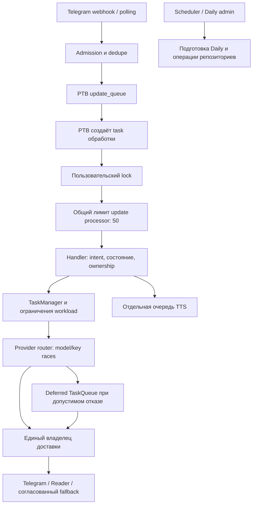

# Аудит обработки запросов, очередей и административных панелей

Дата: **2026-10-28, Europe/Kyiv**. Статус этого документа: **исторический снимок аудита до реализации**. Последующие изменения и границы их проверки описаны в [отчёте реализации](request-processing-dashboard-implementation-2026-10-28.md); findings ниже не являются списком оставшихся ошибок текущего дерева.

Проверен рабочий каталог при HEAD `24bdb6e29a878828e170b0a24d94650809696b5d`, включая уже существовавшие незакоммиченные изменения провайдеров, inline и классификатора thinking. Это снимок локального кода, а не подтверждение состава production. Чужие изменения сохранены.

**Передаваемый исполнителю комплект:** [порядок выполнения и общие ограничения](superpowers/plans/2026-10-28-request-processing-and-dashboards.md), [план обработки и очередей](superpowers/plans/2026-10-28-request-runtime.md), [план Daily](superpowers/plans/2026-10-28-daily-integrity.md), [план наблюдаемости и интерфейсов](superpowers/plans/2026-10-28-operator-dashboards.md).

## 1. Вывод

Архитектура уже содержит полезные механизмы: владение запросом и отменой, ограничения параллелизма, гонки моделей и ключей, ограничение ожидания первого текста, Redis leases, ревизии настроек, CSP, изоляцию отказов источников дашборда. Переписывать её целиком или вводить универсальную очередь для всех операций не требуется.

Основные дефекты находятся **на границах механизмов**:

1. Размер очереди Telegram не ограничивает задачи, которые библиотека уже извлекла и поставила ждать пользовательский lock.
2. Очередь смешивает успешный возврат Python-функции с успешным выполнением задания; неоднозначный ответ Redis может породить две копии задания.
3. Потеря distributed semaphore lease не останавливает прежнего владельца, а recovery очереди не применяет общий предел попыток.
4. Админские операции могут изменить правила уже начатой Daily-игры либо записать результат старой генерации в новый пазл.
5. Несколько кнопок Daily выполняют не то, что обещает интерфейс; сохранение одной части Trivia стирает несохранённый черновик другой.
6. Панели показывают часть нагрузки и усреднённые времена, но не объясняют, где конкретно возникает ожидание. Сам мониторинг повторяет SQL-агрегацию на каждое подключение.

Приоритет — корректность выполнения и данных, затем измеримость, затем дополнительные административные действия. Ни один найденный дефект не объявляется доказанным production-инцидентом.

## 2. Метод и границы доказательств

Использованы исходники, установленная версия python-telegram-bot, текущие тесты, управляемые проверки с искусственными Redis/provider/DB-зависимостями и Chromium с настоящим HTML/CSP, но перехваченными API-ответами.

Обозначения ниже:

- **Воспроизведено** — наблюдалось в изолированной проверке указанного сценария.
- **Подтверждено кодом** — путь и последствия следуют из реализации; live-инцидент или частота не измерялись.
- **Пробел продукта** — предлагаемая возможность, а не нарушение существующего обещания API.
- **P1** — исправлять первой волной: повторная работа, нарушение ограничения ресурса, целостности игры или административного DOM.
- **P2** — следующая волна: скорость, достоверность диагностики, предотвращение ошибок администратора и удобство.

Не читались live `.env`, приватные логи, дампы и персональные данные. Не запускались реальные Telegram-рассылки, платные генерации, production-нагрузка или миграции. Полный test suite, реальные Redis/Postgres integration-тесты и измерения p95/p99 production в этот аудит не входят. Браузерные снимки содержали синтетические данные.

## 3. Как запрос обрабатывается сейчас



### Реальные ограничения и их область действия

| Механизм | Что уже есть | Что он не ограничивает |
| --- | --- | --- |
| PTB `update_queue` | Настраиваемый буфер, по умолчанию 1000; нижняя граница 100 | Уже извлечённые PTB задачи, ожидающие lock/semaphore |
| `UserScopedUpdateProcessor` | До 50 update-обработчиков; пользовательский lock до общего; inline обходит пользовательский lock | Общее число созданных ожидающих task |
| `TaskManager` | До 2500 отслеживаемых задач; `try_submit` для обязательной admission | PTB wrappers и все внешние HTTP-вызовы приложения |
| Heavy / ultra-heavy semaphore | По умолчанию 4 / 1; local + Redis, локальная очередь ожидания ограничена | Полный end-to-end срок ответа; суммарные обращения всех специализированных процессов |
| Provider router | До двух активных model lanes; внутри lane гонка ключей с ограничениями и отменой проигравших | Суммарный бюджет API всех очередей, Daily, TTS и replica |
| `TaskQueue` | Redis priority queues; 3 worker; lease/ACK/NACK/recovery; local fallback на 100 | Redis backlog и размер сериализованных заданий; единый достоверный статус между процессами |
| TTS | FIFO пользователя, 8 заданий на пользователя, 128 всего, лимиты payload и общего объёма | Наблюдаемость этой нагрузки в текущем queue-блоке дашборда |
| Подготовка дня Crocodile | 202 + статус, Redis lease, дедупликация, локальная деградация; timeout 600 s | Все прочие долгие Daily HTTP-операции; согласованность записи с reset пазла |

Источники: [bot.py](../bot.py), строки 398–421; [update_processor.py](../app/update_processor.py), 38–128; [background_tasks.py](../app/utils/background_tasks.py), 53–170; [concurrency.py](../app/adapters/concurrency.py), 35–215; [queue.py](../app/queue.py); [daily_preparation.py](../app/games/daily_preparation.py).

### Скорость и понимание запросов

Router уже запускает конкурентные попытки и выбирает победителя по первому непустому видимому тексту. После начала вывода модель не переключается. Проигравшие задачи отменяются и ожидаются. Текущие незакоммиченные изменения уже учитывают ряд задержек key health и гонок; предлагать добавить эти механизмы заново было бы ошибкой.

В интерактивном сценарии возможны до **6 одновременно активных API-попыток на один логический запрос**: два model lanes × до трёх ключей, если доступны резервы и сработали задержки hedging. Значение heavy concurrency `4` нельзя читать как «не больше четырёх запросов к API». Это верхняя оценка конкретной конфигурации, а не измеренная средняя стоимость.

Политики первого текста зависят от workload/thinking/model: обычные интерактивные пределы находятся в диапазоне 12–30 s, search — 20 s, inline — 6 s либо 10 s для search. Они начинают действовать внутри router, после предыдущих этапов. Они не обещают ответ пользователю за тот же срок от поступления Telegram update. Источники: [router.py](../app/providers/router.py), [stream_types.py](../app/providers/stream_types.py), [request_factory.py](../app/providers/request_factory.py).

Intent routing использует правила для погоды, валют/криптовалют, гороскопов; сложные запросы могут использовать полученные данные как контекст для LLM. Голосовые намерения и источники текста обрабатываются отдельно. Thinking classifier — эвристики текста и истории с сохранением явного выбора пользователя; описание про отдельный быстрый micro-LLM в заголовке файла расходится с реализацией. Нужны корпус качества и причины решения, а не автоматическое добавление ещё одного LLM-вызова. Источники: [intent_router.py](../app/intent_router.py), [voice_intent.py](../app/voice_intent.py), [thinking_classifier.py](../app/thinking_classifier.py).

## 4. Ошибки обработки и очередей

### R01 · P1 · Входной буфер не ограничивает outstanding updates

**Воспроизведено.** PTB 22.8 извлекает update из очереди и при конкурентной обработке создаёт отдельную task до ожидания в `UserScopedUpdateProcessor`. В проверке с `maxsize=100` и 1000 updates одного пользователя очередь стала пустой (`qsize=0`, `full=False`), но остались 1000 незавершённых wrappers и 1000 ссылок на пользовательский lock при одном активном обработчике. Другой пользователь и inline при этом обслуживались — текущая схема действительно сохраняет полезную справедливость между пользователями.

Следствие: webhook видит свободный буфер, хотя объём ожидающих задач продолжает расти. `TaskManager.MAX_TASKS` к этим wrappers не относится. Нужен лимит принятых, но ещё не завершённых updates, освобождаемый на терминальном `task_done`, и проверка реального fetcher PTB. Перенос общего semaphore перед пользовательским lock испортит существующую справедливость и не является достаточным исправлением.

Источник: [bot.py](../bot.py), 398–421 и webhook admission около 575; [update_processor.py](../app/update_processor.py), 93–103; установленный `.venv/Lib/site-packages/telegram/ext/_application.py`, 1212–1246. План: **R1**.

### R02 · P2 · Бюджеты ожидания складываются, а не образуют общий срок

**Воспроизведено управляемыми часами.** При timeout 120 s локальная фаза может занять 119 s, затем Redis-фаза начинает собственный отсчёт и допускает ещё около 120 s. Провайдерный срок начинается позже. Это почти 239 s до генерации в соответствующем сценарии.

У Redis-клиента уже есть socket/connect timeout по 5 s и retry-on-timeout; утверждать, что сетевых timeout совсем нет, неверно. Проблема — отсутствие единого monotonic deadline операции admission, включающего обе фазы и повторные I/O. Нужны остаточный бюджет и отдельная ограниченная уборка. End-to-end SLO разных workload следует установить после измерений, а не приравнять все операции к 12 s.

Источники: [concurrency.py](../app/adapters/concurrency.py), 87–145; [cache.py](../app/cache.py), 45–50. План: **R2**, измерения **O1**.

### R03 · P1 · Потерянный semaphore token не останавливает владельца

**Воспроизведено.** Renewal выполняет `ZADD XX`, не проверяя факт владения. Возвращаемое Redis значение `0` само по себе не отличает обновлённый существующий member от отсутствующего. После исчезновения token прежняя работа продолжается, новый владелец получает освободившийся слот. В проверке с limit=1 одновременно работали два владельца при одном member в Redis.

Нужны Lua-проверка наличия + продление, подтверждение lease и прекращение принадлежащей запросу работы при доказанной потере или истечении неподтверждённого lease. Не восстанавливать исчезнувший token задним числом. Локальная деградация при недоступности Redis — отдельная осознанная политика: на N процессах она может дать N × limit, что следует показывать оператору.

Источник: [concurrency.py](../app/adapters/concurrency.py), 22–58. План: **R2**.

### Q01 · P1 · Возвращённая бизнес-ошибка считается выполненным заданием

**Воспроизведено.** Worker после любого нормального возврата handler ставит `COMPLETED` и делает ACK. Deferred handler ловит ошибку доставки или неуспешный outcome и возвращает `{"status":"failed"}`. Результат: задание завершено по очереди, повтор не назначен, локальный счётчик completed увеличен; событие при этом может содержать business failure.

Нужен типизированный результат: succeeded / retryable failure / permanent failure / неизвестный исход доставки. Повторять каждую ошибку нельзя: Telegram мог принять сообщение до потери ответа. `PartialDelivery` нельзя автоматически превращать в повторную полную отправку.

Источники: [queue.py](../app/queue.py), 700–716; [deferred_response.py](../app/deferred_response.py), 129–135. План: **R3**.

### Q02 · P1 · Потеря подтверждения Redis создаёт вторую локальную копию

**Воспроизведено.** Если Redis выполнил LPUSH, но клиент получил исключение вместо ответа, `add_task` кладёт то же задание в local fallback. Worker пропускает из локального cache только cancelled, а не уже исполненную копию. Поддельный Redis «commit, затем disconnect» привёл к двум вызовам handler даже в одном процессе.

Нужны стабильный task/idempotency key, атомарная admission и состояние «подтверждение неизвестно». После предпринятой Redis-записи нельзя независимо запустить локальную копию. Восстановление по тому же ключу должно вернуть существующее задание. Это предотвращает конкретный дубль, но не создаёт exactly-once гарантию для внешнего Telegram API.

Источник: [queue.py](../app/queue.py), 458–475, 657–659. План: **R4**.

### Q03 · P1 · Recovery обходит предел попыток

**Воспроизведено.** Восстановление задания умершего worker увеличивает `retry_count`, не проверяя максимум. Последовательные recovery дали значения 1, 2, 3, 4, 5 при максимуме 3. Предел применяется только к исключениям из обычного handler.

Нужен единый счётчик запусков, включающий interrupted attempts, и терминальное состояние/dead letter вместо бесконечного crash loop. Повторное чтение уже восстановленного элемента не должно расходовать попытку повторно.

Источник: [queue.py](../app/queue.py), 340–365 и 755–763. План: **R3**, **R4**.

### Q04 · P2 · Redis backlog не ограничен; cooldown занимает worker

**Подтверждено кодом.** Local fallback ограничен 100 заданиями, Redis backlog — нет. Deferred history ограничивается десятью записями, но не числом байтов текста. Каждый deferred handler занимает worker на три ожидания по 5 s ещё до генерации. При трёх workers один только этот cooldown даёт верхнюю оценку около 12 запусков в минуту; реальная производительность будет ниже и здесь не измерялась.

Нужны отдельные ограничения количества/байтов/возраста, delayed scheduling через `not_before`, backoff с jitter и честная admission-ошибка. У exception retry сейчас нет планируемой задержки; у deferred cooldown есть — это разные пути.

Источники: [queue.py](../app/queue.py), 431–499, 592–631, 755–784; [deferred_response.py](../app/deferred_response.py), 52–73, 92–104. План: **R4**.

### Q05 · P2 · Статус и отмена TaskQueue существуют только в памяти процесса

**Воспроизведено между двумя экземплярами.** Producer может вернуть успешную отмену из своего `self.tasks`, но другой worker продолжает выполнять сериализованную копию. Статус на producer может остаться pending. Это не утверждение о неисправности обычной команды `/cancel`: её ownership реализован отдельно. У `cancel_user_task` сейчас не найден действующий внешний продуктовый caller.

Перед добавлением кнопок управления очередью нужен общий источник статуса, ревизия, owner token и различие `cancel_requested` / `cancelled`. «Принята просьба остановить» не равно «внешнее действие отменено».

Источник: [queue.py](../app/queue.py), 501–527, 871–886. План: **R4**, интерфейс **O3**.

### Q06 · P2 · Local fallback не сохраняет FIFO внутри приоритета

**Подтверждено кодом.** Ключ PriorityQueue — `(-priority, task_id)`, где UUID определяет порядок равноприоритетных заданий. Redis LPUSH/RPOP уже даёт FIFO внутри приоритета. Дополнительный риск strict priority — starvation низкого приоритета при непрерывном высоком; такой production-инцидент не измерялся.

Исправить локальный ключ на `(priority, enqueue_sequence, task_id)`. При добавлении Daily workers использовать отдельные workload lanes с резервированными workers, а не пускать генерацию картинок в общую очередь deferred ответов. План: **R3**, **D6**.

## 5. Что умеют панели сейчас

| Панель / раздел | Реализованная функциональность | Чего оператор не видит или не может безопасно сделать |
| --- | --- | --- |
| `/`, Overview | Состояние сервисов, CPU/RAM/disk, нагрузка, среднее время; трафик today/7/30 календарных дней | Разложение времени по этапам; достоверная готовность bot worker; общий outstanding workload |
| `/`, Providers | Gemini по моделям/маскированным ключам, лимиты/RPD, Tavily, circuit breakers и здоровье ключей | Стоимость hedging в попытках на запрос, доля победителей/отмен, latency по workload и маршруту |
| `/`, Infrastructure / Errors | DB/cache/pool и TaskQueue; operational counters/errors | Другие очереди, возраст старейшего задания, delayed/retrying/dead-letter, межпроцессная область статуса |
| `/controls` | Process routing, порядок/стратегии моделей, inheritance; prompts preview/diff; TTS voices; aliases; catalogs; reset/restore и история | Панель активных заданий, безопасные cancel/retry/drain; причины ожидания и связь запроса с конкретной ревизией |
| Daily, Broadcast | Переключатели каналов, подписчики/фильтры/страницы, offer history, одиночная и batch-отправка, режим Daily по умолчанию | Полный журнал ошибок доставки и неизвестных исходов; управляемый batch job после перезагрузки страницы |
| Daily, Crocodile | Easy/Hard, последние пазлы, картинки/proxy, prompt/model, shared + role models, image quota, подготовка выбранного дня | Надёжный конфликт редактора и генератора; защита уже начатой игры; общий календарь готовности |
| Daily, 2048 | Board, цель, spawn sequence, seed, par/time, status, solution, генерация default, обложка | Реальное применение draft/disabled при запуске; блокировка изменения правил сыгранного пазла |
| Daily, Trivia | 5 main + 3 super, edit/save/regenerate отдельно, CAS revision, банк фактов/дедупликация, leaderboard | Сохранение независимых черновиков и понятный конфликт без потери введённого |
| Daily, Horoscope | Статистика подписок и знаков | Достоверная доставка по конкретному дню/пользователю и диагностика причин отказов |
| Daily, Tarot | Readiness today/tomorrow, карточки/счётчики, regenerate | Кнопка regenerate не передаёт force/model; sent/pending отсутствуют в данных |

Источники: [dashboard.html](../app/templates/dashboard.html), [controls.html](../app/templates/controls.html), [controls.js](../app/static/js/controls.js), [web_controls.py](../app/web_controls.py), [admin_daily.html](../app/templates/admin_daily.html), [web.py](../app/web.py).

Сильные стороны `/controls` нужно сохранить: CSRF и ограничения JSON, optimistic concurrency через `expected_revision`, снимок настроек на операцию, last-known state при отказе источника, безопасные текстовые DOM-операции, ленивую диагностику. Главная панель уже различает пользовательские запросы и API attempts, учитывает полноту исторического покрытия и неизвестные значения. Не заменять unknown на 0.

## 6. Ошибки Daily и редакторов

### D01 · P1 · Draft/disabled 2048 доступны для игры

**Воспроизведено.** `ensure_puzzle` возвращает существующий пазл независимо от статуса; start создаёт active result. В проверке оба значения draft и disabled позволили начать игру. Фильтрация списка в UI не исправит прямой Telegram/API путь.

Ввести доменную проверку статуса для старта и ходов. Draft не запускать; disabled блокирует новые игры и новые ходы, сохраняя результаты. Различать отсутствующий пазл и намеренно отключённый. Источники: [repos/daily_2048.py](../app/repos/daily_2048.py), 388–413; [games/daily_2048.py](../app/games/daily_2048.py), 197–198, 295–313. План: **D1**.

### D02 · P1 · Правила 2048 изменяются под уже начатой игрой

**Подтверждено кодом.** Upsert обновляет gameplay-поля, а следующий move читает текущий пазл. Result не закрепляет версию spawn sequence/goal. Возможны разные правила для участников одной даты и изменение правил во время партии. При auto-create также нужен insert-if-absent вместо перезаписи конкурентной ручной публикации.

Минимальная рекомендуемая политика: после появления любого result запрещать изменение gameplay-полей на эту дату; статус доступности менять отдельно. Добавить CAS revision. Проверку «пазл ещё не играли» и создание result синхронизировать одним DB row lock. Полное версионирование партий — отдельное будущее расширение, не обязательное условие исправления.

Источник: [repos/daily_2048.py](../app/repos/daily_2048.py), 332–408, 431–448; [games/daily_2048.py](../app/games/daily_2048.py), 295–313. План: **D1**.

### D03 · P1 · Reset слова Crocodile сохраняет прогресс старого слова

**Подтверждено кодом.** Reset меняет puzzle, но results остаются привязаны к date/difficulty. Следующая проверка ответа использует новое слово. UI обещает удаление прогресса, которого backend не выполняет.

Рекомендуется не удалять результаты: запретить изменение слова/подсказок/игровой картинки после первого result для этой date/difficulty, предложить подготовить будущую дату. Проверка и старт игры должны использовать общий row lock. Обложку игры и глобальные настройки будущих генераций это ограничение не затрагивает.

Источники: [repos/crocodile_daily.py](../app/repos/crocodile_daily.py), 466–546, 626–641; [crocodile_daily.py](../app/games/crocodile_daily.py), путь judge; [admin_daily.html](../app/templates/admin_daily.html), около 2167. План: **D2**.

### D04 · P1 · Старая генерация записывает assets после reset

**Воспроизведено.** Подготовка начала генерировать подсказки для старого слова, reset заменил слово, затем прежние hints/prompt записались в обновлённую строку и она стала prepared. Существующий Redis lock подготовки (180 s) не связывает все reset/edit/setter-пути; одного увеличения TTL недостаточно.

Нужны content revision и отдельный generation token, CAS при записи hints/prompt/image/prepared, invalidation при изменении контента. Долгие API-вызовы остаются вне DB-транзакции; запись результата происходит короткой проверяемой транзакцией. Прежний worker после потери lease не может писать в новую генерацию.

Источники: [repos/crocodile_daily.py](../app/repos/crocodile_daily.py), 548–624; [games/crocodile_daily.py](../app/games/crocodile_daily.py), подготовка около 581. План: **D2**.

### D05 · P2 · Сохранение Crocodile prompt сбрасывает image model

**Подтверждено кодом.** Prompt endpoint вызывает setter без image model; аргумент setter имеет default и SQL перезаписывает модель. Пользователь изменил текст, но потерял выбранную модель картинки. Отсутствующий model должен означать «сохранить прежний»; явная смена модели — отдельное действие.

Источники: [web.py](../app/web.py), около 1129; [repos/crocodile_daily.py](../app/repos/crocodile_daily.py), 561–579. План: **D3**.

### D06 · P2 · Daily model controls обходят ревизию открытого редактора

**Подтверждено кодом.** `/controls` отправляет клиентскую revision, а совместимые Daily writers получают свежую revision только в момент POST. Устаревший Daily UI может сбросить уже обновлённую chain другого администратора через Auto. Trivia model editor имеет тот же класс проблемы.

GET должен отдавать ревизию; POST обязан передавать именно её. На 409 сохранять выбранное пользователем значение и показывать сравнение. Немедленная bot-команда, не являющаяся старой формой браузера, может оставаться отдельным writer с fresh revision.

Источники: [runtime_settings/processes.py](../app/runtime_settings/processes.py), 9–37; [legacy_models.py](../app/runtime_settings/legacy_models.py), 29–50; [web.py](../app/web.py), Daily settings endpoints. План: **D3**.

### D07 · P2 · Tarot regenerate не делает заявленную перегенерацию

**Воспроизведено.** UI отправляет date/model, backend вызывает `prepare_daily_readings(target_date=...)` без model и force. Когда все 156 чтений уже существуют, успешный ответ может содержать generated=0/skipped=156. Выбранная модель не используется как аргумент.

Разделить «дополнить отсутствующие» и «перегенерировать», передавать force и выбранный effective model с понятным приоритетом относительно process override. Нельзя обещать использование выбранной модели, если runtime policy затем его молча заменит. Долгую работу оформить как job.

Источники: [web.py](../app/web.py), 2908–2934; [tarot_daily.py](../app/tarot_daily.py), 160–246; [admin_daily.html](../app/templates/admin_daily.html), 2969–2980. План: **D4**, **D6**.

### D08 · P2 · Trivia теряет несохранённую соседнюю часть

**Воспроизведено в Chromium.** Изменить поле super, сохранить main: `loadPuzzles` перерисовывает всю форму, super возвращается к серверному значению. Аналогичный риск есть при смене даты, regenerate и ответе 409. CAS backend защищает сервер от stale save, но не сохраняет браузерный черновик.

Хранить base revision и drafts main/super отдельно, dirty-state для каждой части, после сохранения менять только сохранённую часть. При внешнем конфликте не переписывать поля автоматически. Не сохранять тексты в постоянное browser storage без необходимости.

Источник: [admin_daily.html](../app/templates/admin_daily.html), 2689–2780. План: **D5**.

### D09 · P1 · Crocodile prompt вставляется как HTML

**Воспроизведено в Chromium с настоящим CSP.** Безопасный тестовый HTML-маркер в `image_prompt` стал DOM-элементом внутри `.puzzle-prompt`, а не буквальным текстом. Значение также вставляется в textarea через HTML-шаблон. **Исполнение JavaScript не доказано; это подтверждённая HTML-инъекция, не заявленный обход CSP.**

Заменить вставку динамических значений на `textContent` и `.value`, оставив HTML только для статической структуры. CSP сохранить. Проверить остальные поля этой карточки и отрицательные браузерные примеры. Источник: [admin_daily.html](../app/templates/admin_daily.html), 2082–2101. План: **D5**.

### D10 · P2 · Долгие Daily mutations привязаны к HTTP-запросу

**Подтверждено кодом / пробел продукта.** Regenerate/reset, часть Trivia authoring, Tarot и batch send ожидают внешнюю работу внутри HTTP. Закрытие страницы или потеря ответа не дают оператору надёжного ответа, выполнена ли операция. Уже существующий day preparation — полезное исключение: имеет job/status/Redis lease; переделывать его как будто этих механизмов нет не нужно. Но admission через `submit_task` способна вернуть queued до обнаружения отказа TaskManager.

Нужны ограниченные jobs с idempotency key, conflict key, статусом после reload и отдельными workers для Daily. Уменьшение frontend timeout без такого протокола создаст больше повторных запусков. План: **D6**, после исправления очереди **R4**.

### D11 · P2 · Нет полного журнала доставки

**Подтверждено кодом / пробел продукта.** `/api/admin/broadcast/errors` — явная заглушка с пустым списком. Offer history полезна, но не заменяет журнал исходов каждой отправки. Tarot `sent/pending` возвращаются как неизвестные значения; текущая UI их скрывает, поэтому нельзя обвинять её в отображении ложного нуля.

Добавить записи попыток/исходов, recipients snapshot для batch, safe reason codes, retry only failed, unknown delivery как отдельный исход. Существующие consent/unsubscribe правила проверять перед каждой реальной отправкой. План: **D7**.

## 7. Наблюдаемость, производительность панели и UX

### O01 · P2 · Стоимость мониторинга растёт с количеством вкладок

**Подтверждено кодом.** Full snapshot вызывается примерно каждые 15 s; SSE каждой вкладки каждые 5 s заново вызывает `get_traffic_summary`, который выполняет SQL за 30 дней под `_flush_lock`. Full snapshot тоже получает эту агрегацию. Получается примерно 16 чтений агрегации в минуту на вкладку в установившемся режиме, до дополнительных diagnostics. Это оценка количества вызовов по коду, не измерение времени SQL.

Общий single-flight cache на backend по источнику/области прав, TTL и время наблюдения. SSE передаёт свежий лёгкий снимок и изменения версии; не запускает полную агрегацию для каждого клиента. Сохранить accounting-инварианты `_flush_lock`, исправлять частоту чтения, а не убирать lock без доказательства.

Источники: [web.py](../app/web.py), 937–995; [metrics.py](../app/metrics.py), 254–347, 825. План: **O2**.

### O02 · P2 · Панель не показывает все очереди и причины задержки

**Подтверждено кодом / пробел продукта.** Queue card отражает `TaskQueue`; за её пределами PTB outstanding, TaskManager, heavy waiters, TTS и Daily jobs. Operational metrics уже собирают длительности, но хранят count/sum; среднее по смешанным запросам не показывает хвост задержек. `bot_status: running` в snapshot — константа, а не проверка жизненного цикла worker. LIVE/fresh у транспорта также не означает доступность каждого источника.

Добавить обзор workload lanes, active/pending/delayed/retrying/oldest_age, явные local/distributed/degraded, p50/p95/p99 по небольшому фиксированному набору этапов/workload. Отделить first visible text от первого provider event и total delivery. Настоящая готовность бота должна идти от lifecycle, источники — иметь собственные observed_at/age/error. Не показывать пользовательские тексты, raw key, private IDs в общих метриках.

Источники: [observability/metrics.py](../app/observability/metrics.py), 66–150; [metrics.py](../app/metrics.py), 772–825; [web.py](../app/web.py), сборка snapshot. План: **O1–O3**.

### U01 · P2 · Daily: даты, узкий экран, клавиатура и сохранение форм

**Подтверждено кодом и визуальным осмотром.** 2048 `todayIso` и Tarot default date используют UTC, хотя доменные даты Daily — Kyiv: в первые часы местного дня возможен выбор предыдущей даты. Crocodile grid имеет минимальную колонку 340 px и переполняет viewport 320 px; строка подготовки дня также не переносится. Многие формы имеют не связанные с input labels; tabs/modal не обеспечивают полный keyboard/focus contract; toast не имеет live announcement.

Использовать единую серверную `today`/timezone, сетку `minmax(min(100%, 340px), 1fr)` и перенос action rows. Вкладки, диалог, focus return/Escape, `aria-live`, имена кнопок и dirty предупреждения проверять реальными клавиатурными сценариями. Эти рекомендации согласуются с [Web Interface Guidelines](https://raw.githubusercontent.com/vercel-labs/web-interface-guidelines/main/command.md); автоматическая проверка атрибутов не заменяет браузерный сценарий.

Источники: [admin_daily.html](../app/templates/admin_daily.html), 414, 2243, 2969. План: **O4**.

### U02 · P2 · У административных fetch нет общего ограниченного ожидания

**Подтверждено кодом.** Главный monitoring polling уже использует timeout/single-flight. Общий API wrapper `/controls` и многие Daily fetch ждут без AbortController deadline; busy state может держаться до внешнего сетевого timeout. Не нужно переписывать исправный polling главной панели.

Общий helper для административных read/short mutations, отмена superseded GET, защита от устаревшего ответа, отдельная обработка 401/403/409/429/503. Для POST timeout означает «результат неизвестен», после чего нужна сверка idempotency/revision; автоматическая повторная mutation недопустима. План: **O4**, после job protocol **D6** для долгих операций.

### I01 · P2 · Нет измеряемого договора качества intent/thinking

**Пробел продукта.** Есть точечные тесты, но нет согласованного набора коротких/сложных RU/UK запросов, отрицаний, цитат, продолжений истории, явного thinking и голосовых источников с ожидаемым route/fallback. По коду нельзя честно назвать процент понимания.

Добавить версионируемый offline corpus и агрегированный отчёт без текстов production, причины принятого маршрута/уровня, отдельно неверные shortcut и безопасный fallback. Не менять heuristic weights без regressions и измеримой цели. План: **O5**.

## 8. Что стоит добавить после исправлений

| Возможность | Польза | Условие готовности |
| --- | --- | --- |
| Обзор всех очередей и этапов запроса | Видно, где ожидает работа и что перегружено | R1–R4, O1; scope и freshness у каждого источника |
| Read-only список jobs, затем cancel/retry/pause admission | Оператор может устранить конкретное зависание | Общий status store, owner fencing, журнал действий; неизвестную доставку не повторять автоматически |
| Календарь Daily на 8 дат: сегодня + 7 | Видно готовность каждого режима, missing assets и связанные jobs | D1–D6; чтение не запускает генерацию |
| Preflight перед генерацией/рассылкой | Показывает затронутые даты/части, модель, наличие игроков, число получателей/работ | Без придуманной денежной оценки; тарифы/лимиты только из проверяемого источника |
| Конфликт редактора с сохранением черновика | Нет тихой потери работы и чужих настроек | CAS всех writers, независимые drafts, explicit reload/merge |
| Журнал delivery и повтор определённо неуспешных | Понятно, кому не отправлено и почему | D7; consent повторно проверяется перед отправкой |
| Effective configuration на job/request | Объясняет, какая chain/revision реально использовалась | Snapshot настроек закреплён на операцию, payload ограничен и очищен |

Не включать в первую волну новый frontend framework, Celery/Kafka, универсальный provider router для специальных API, произвольное редактирование concurrency из UI или multi-replica bot state. Нет измерений, оправдывающих такие изменения. Process-local состояние и ownership требуют отдельного проекта для полноценного горизонтального масштабирования.

## 9. Выполненная проверка

**371 offline-тест + 6 Chromium-тестов прошли; 5 случаев отфильтрованы browser marker.** Это выбранные наборы для аудита, не заявление о прохождении всего репозитория и не тесты всех новых найденных сценариев. Большинство новых сценариев пока существуют как безопасные одноразовые проверки; их требуется закрепить тестами в планах ниже.

```powershell
uv run --locked pytest tests/test_task_queue.py tests/test_redis_queue.py tests/test_queue_retry_capacity.py tests/test_update_processor.py tests/test_concurrency.py tests/test_concurrency_hardening.py tests/test_request_capacity_admission.py tests/test_dashboard_snapshot.py tests/test_dashboard_backend.py tests/test_dashboard_runtime.py tests/test_web_controls.py tests/test_runtime_settings_store.py tests/test_daily_preparation.py tests/test_daily_admin_errors_js.py tests/test_daily_croc_admin_js.py tests/test_admin_daily_broadcast.py -m "not integration and not browser" --override-ini="addopts=" --timeout=30 -q
# 154 passed in 15.14s

uv run --locked pytest tests/test_provider_model_hedge.py tests/test_provider_key_hedge.py tests/test_provider_stream_types.py tests/test_provider_race_protocol_contracts.py tests/test_thinking_classifier.py tests/test_source_inventory.py tests/test_command_inventory.py tests/test_webhook_admission.py tests/test_webhook_dedupe.py tests/test_cancel_generation_ownership.py tests/test_direct_intent_admission_ownership.py tests/test_voice_queue_resilience.py -m "not integration and not browser" --override-ini="addopts=" --timeout=30 -q
# 217 passed in 14.45s

$env:GEMAIBOT_REQUIRE_BROWSER_TESTS = "1"
$auditBrowserDir = Join-Path $env:TEMP ("gemaibot-dashboard-audit-" + [guid]::NewGuid().ToString('N'))
uv run --locked pytest tests/test_dashboard_diagnostics_browser.py tests/test_controls_ui.py tests/test_controls_commands_browser.py tests/test_controls_audio_browser.py tests/test_admin_daily_browser_security.py tests/test_admin_dailycroc_csp.py -m browser --override-ini="addopts=" --timeout=30 --basetemp=$auditBrowserDir -q
# 6 passed, 5 deselected in 23.03s
```

Дополнительно выполнены управляемые проверки: настоящий fetcher PTB с 1000 updates; потеря semaphore token и суммарный бюджет admission; queue commit-then-disconnect, ошибочный returned outcome и повторный recovery; 2048 draft/disabled; reset во время Crocodile preparation; Tarot skip вместо force; Trivia draft loss и инертный HTML-маркер Crocodile под CSP. Они не выполняли внешние действия.

Номера строк служат навигацией для этого снимка. Перед реализацией проверять актуальные функции и условия заново: параллельная работа над router/inline/thinking уже шла во время аудита.
